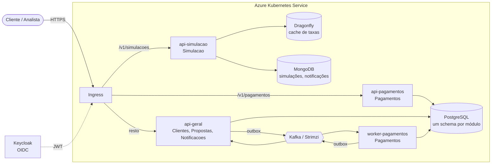

# CreditFlow

Plataforma de **crédito pessoal** em **ASP.NET 10 (C# 14)**, construída como **monolito modular com DDD**
e desenhada para rodar no **Azure Kubernetes Service**: simulação de empréstimo (Price e SAC, IOF, CET),
cadastro com consentimento LGPD, propostas com análise e contratação, desembolso por PIX simulado com
saga e Kafka, notificações.

É um projeto de estudo e portfólio, construído em módulos, com um curso que explica cada decisão:
por que monolito modular e não microsserviços, como escalar só o módulo que precisa (perfis de execução),
como calcular dinheiro sem perder centavo, como garantir que um evento não se perde (outbox) nem se repete
(inbox), como entregar com Helm, Harbor, Argo CD e Terraform.

> **English summary.** CreditFlow is a personal-loan platform built as a modular monolith with DDD on
> ASP.NET 10, targeting AKS. One container image runs as several deployments ("execution profiles") so the
> CPU-bound loan simulator and the Kafka-driven payments worker scale independently. Highlights: a tested
> loan engine (Price/SAC amortization, IOF tax, APR via Newton-Raphson IRR, cross-checked against an
> independent Python implementation), architecture tests that enforce module boundaries, outbox/inbox with
> Kafka, Keycloak, PostgreSQL + MongoDB, Dragonfly cache, Helm, Argo CD, Terraform. Docs are in Portuguese.

## Arquitetura



Os quatro deployments (`api-simulacao`, `api-pagamentos`, `api-geral`, `worker-pagamentos`) são **a mesma imagem**, subida com `CREDITFLOW__MODULOS` e `CREDITFLOW__PAPEL`
diferentes ([ADR 0002](docs/adr/0002-perfis-de-execucao.md)).

```
src/Host/CreditFlow.Host                      o processo: lê o perfil, liga os blocos transversais, carrega os módulos
src/BuildingBlocks/CreditFlow.BuildingBlocks  Result/Erro, Dinheiro/Cpf/Percentual, IModule, Auth, Mensageria, Observabilidade
src/Modules/<Modulo>/CreditFlow.Modules.X            Domain, Application, Infrastructure, Api
src/Modules/<Modulo>/CreditFlow.Modules.X.Contracts  a única parte que outros módulos enxergam
tests/                                        arquitetura, unidade por módulo, integração (Testcontainers)
deploy/  infra/  gitops/  load/               Docker, Helm, k8s, Terraform, Argo CD, k6
docs/adr/                                     decisões de arquitetura
```

## Decisões de engenharia que valem a leitura

- **Fronteiras que quebram o build.** Testes de arquitetura (NetArchTest + leitura dos `.csproj`) impedem
  um módulo de referenciar outro que não seja `.Contracts`, e o domínio de depender de EF Core, Mongo, Kafka
  ou ASP.NET ([ADR 0001](docs/adr/0001-monolito-modular.md)).
- **Uma imagem, quatro deployments.** Simulação escala por CPU, o worker de Pagamentos pelo lag do Kafka,
  sem virar microsserviços. Configuração inválida derruba a subida.
- **Dinheiro conferido de dois jeitos.** O motor de cálculo (Price, SAC, IOF, CET por TIR com Newton-Raphson)
  usa `decimal`, centavos exatos com ajuste na última parcela, e os valores esperados dos testes vêm de uma
  implementação independente em Python, com o CET conferido ainda por bisseção.
- **LGPD no modelo.** Consentimento por finalidade, revogável e com histórico; CPF sempre mascarado na saída
  e no `ToString()`; outros módulos recebem score e renda, nunca CPF ou nome.
- **Erros previsíveis.** `Result<T>` com código estável, traduzido num lugar só para ProblemDetails (RFC 9457).
- **Endpoint público protegido.** Simulação sem login, com rate limit por IP e 429 com `Retry-After`.

> Valores, alíquotas e fórmulas de IOF e CET são **didáticos**. Antes de usar em qualquer coisa real,
> confira a regulação vigente (Banco Central, Receita Federal).

## Como rodar

Requer o [.NET 10 SDK](https://dotnet.microsoft.com/download/dotnet/10.0) e Docker.

```bash
docker compose -f deploy/local/docker-compose.yml up -d     # Postgres, Mongo, Dragonfly, Kafka, Kafka UI, Keycloak
dotnet build
dotnet test
dotnet run --project src/Host/CreditFlow.Host               # http://localhost:8080/scalar
```

| Serviço local | Endereço |
|---|---|
| API + Scalar | http://localhost:8080/scalar |
| OpenAPI | http://localhost:8080/openapi/v1.json |
| Keycloak (admin/admin) | http://localhost:8081 |
| Kafka UI | http://localhost:8085 |
| Postgres / Mongo / Dragonfly / Kafka | 5432 / 27017 / 6379 / 9092 |

Simular um empréstimo (público):

```bash
curl -s -X POST localhost:8080/v1/simulacoes -H 'Content-Type: application/json' \
  -d '{"valor":10000.00,"prazoMeses":12,"sistema":"price"}'
```

Rodar só o perfil de simulação, como no cluster:

```bash
CREDITFLOW__MODULOS=Simulacao CREDITFLOW__PAPEL=api dotnet run --project src/Host/CreditFlow.Host
```

## Curso

As lições ficam no learnFlow, em `projetos/creditflow/docs`.
Cada módulo do curso tem uma tag neste repositório (`modulo-01`, `modulo-02`...).

## Licença

MIT
